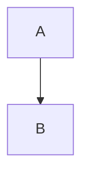

Links: [[chapter-1_computer-architecture|Chapter 1]], [[chapter-1_computer-architecture]], [[chapter-1_computer-architecture#Moore's Law]] and [[#Lists]]. A ==highlight with **bold**== and `a === b`.%%a private note%% A block id ^abc123

%%
A comment over
several lines.
%%

# Lists
- one
	- nested by a tab
		- and again
- [ ] a task
- [x] a done task

> [!note]
> A plain note.

> [!warning] Mind the gap
> With its own title.

> [!tip]- Folded
> Opens without JavaScript.

| Disk | RAM |
|---|---|
| ms | µs |

```python
def read(path):
    return open(path).read()  # %% not a comment in code
```


