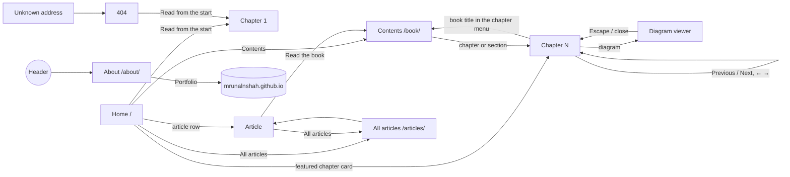

# Flows: System Design from First Principles (website)

The header (book title → Home, name → About, Contents, Articles, portfolio) is on every screen, so every screen reaches every top-level screen in one step.

## Preview order (Gate GD)
1. J1: Home → Chapter 1 (light, then dark) → diagram viewer → Next / last chapter state.
2. J2: Home → featured chapter card → chapter menu (wide and phone sheet) → Contents.
3. J3: Home → article row → Article → All articles (default and empty).
4. J6: Header name → About → portfolio link.
5. 404.
6. J5 (publish) has no screen of its own; the preview shows a sample build-error message instead.
