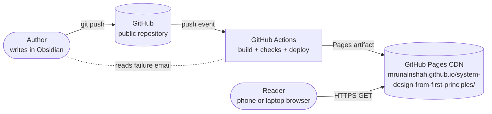
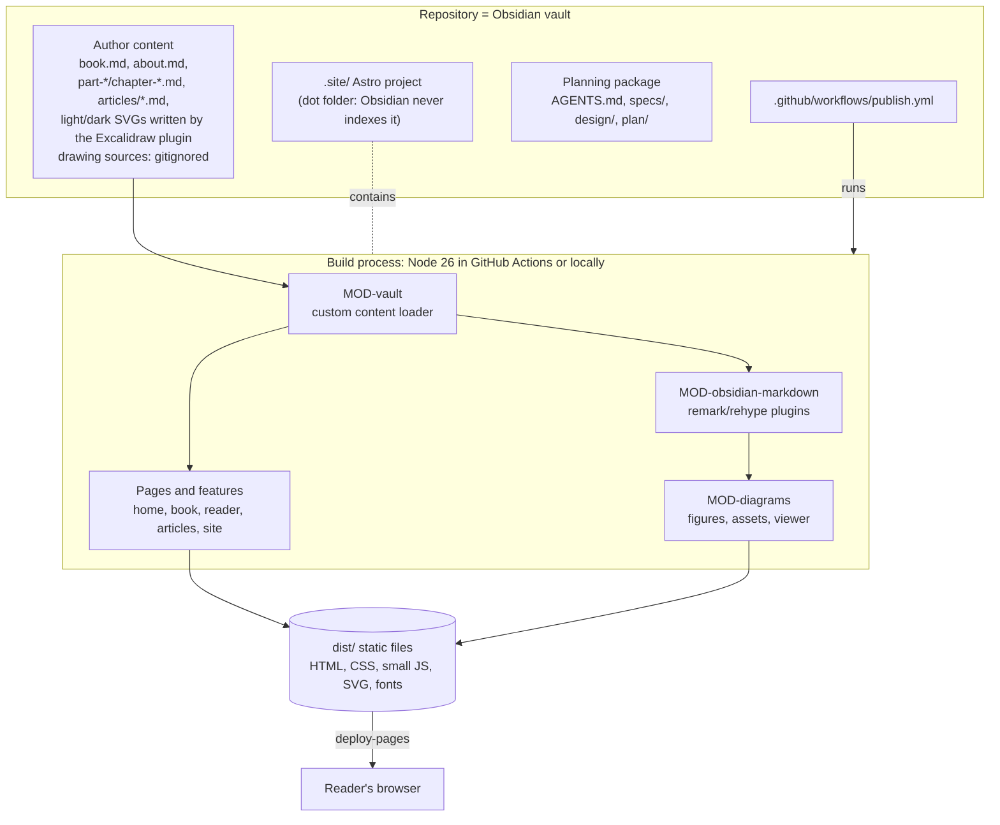

# Architecture: System Design from First Principles (website)

## Drivers
- Quality attributes, ranked:
  1. **Source fidelity and diagram quality** (signature 1, NFR-009, NFR-010): every vault file renders as it does in Obsidian, and diagrams are perfect in both themes.
  2. **Calm, fast reading without JavaScript** (signature 2, NFR-001, NFR-002, NFR-004, NFR-011).
  3. **Maintainability by a light coder with an AI agent** (NFR-013, REQ-CNT-007): one deep content module, plain-language build errors, no runtime to operate.
  4. **Privacy and cost** (NFR-007, NFR-008): $0, no cookies, no third-party requests.
  5. Accessibility (NFR-003), a non-negotiable floor rather than a trade-off.
- Constraints: one author, light coding, about 10 h a week, no deadline. A public GitHub repository and GitHub Pages under `/system-design-from-first-principles/` (CNF-003). Astro 7.4.13 on Node 26.13.1 (ADR-0001). The repository root *is* the Obsidian vault, and the author's files are never rewritten by tooling.

## Candidate designs
| | Option A: **Content-loader monolith** | Option B: **Pre-compile pipeline** |
|---|---|---|
| Shape | One Astro project. A custom Astro content loader (MOD-vault) reads the vault, validates frontmatter, orders the book and renders each entry with one general-purpose Obsidian Markdown module (MOD-obsidian-markdown). Pages are thin and read typed collections | A separate Node script first converts the vault into standard Markdown plus copied assets in a generated folder; Astro then builds that folder with its stock `glob()` loader |
| Fit to the top attributes | **Fidelity:** Obsidian knowledge lives in one module that sees the original files, so errors can name the original file and line. **No JS:** Astro default. **Maintainability:** one build, one command, one place to change | **Fidelity:** conversion can lose information (callouts, pair detection, positions) and needs source maps to report original lines. **Maintainability:** two steps whose order matters (temporal decomposition), duplicated content on disk, two places that know the format |
| Cost and complexity | Lower: one process, about 6 plugins behind one factory function. Depends on Astro's loader API (spike S-01) | Higher: an intermediate format to design and keep stable; more moving parts for a light coder |

Chosen: **A**, see ADR-0003 (content loading). The repository layout is in ADR-0002, the Markdown module design in ADR-0004, diagrams in ADR-0005 and the diagram source workflow in ADR-0012, progressive enhancement in ADR-0006, URLs and the base path in ADR-0007, math in ADR-0008, chapter addresses in ADR-0009, styling in ADR-0010 and environments in ADR-0011.

## System context

There is no server of our own, no database and no third-party service at runtime (NFR-008, NFR-012).

## Containers

## Components
Build-time modules inside `.site/src/features/`, each with one public `index.ts` (details in modules.md):
- **MOD-vault** (`content/`): vault scanning, classification, frontmatter schemas, ordering, drafts, summaries, reading time, book settings; exposes typed `Book`, `Chapter`, `Article`, `Page`.
- **MOD-obsidian-markdown** (`markdown/`): general-purpose Obsidian-flavoured Markdown → HTML, with headings, footnotes and build issues. Knows nothing about books.
- **MOD-diagrams** (`diagrams/`): diagram pairs, sizes, alt text from Excalidraw sources, figure markup, asset routes, the full-screen viewer script.
- **MOD-book** (`book/`): contents, previous/next, Roman numerals, chapter numbering for display.
- **MOD-reader** (`reader/`): the reading layout, chapter title, epigraph, margin-note layout, chapter menu, keyboard navigation.
- **MOD-home** (`home/`) and **MOD-articles** (`articles/`): homepage sections; archive and article page.
- **MOD-site** (`site/`): the URL builder and base path, layouts, header, footer, metadata, sitemap, 404, the token-generated CSS, the security meta tags.
- `src/pages/**`: thin route files that call feature components (no logic).

Client-side JavaScript (progressive enhancement only, ≤ 60 KB compressed in total): the diagram viewer (MOD-diagrams), the chapter menu sheet and scrollspy, margin-note toggles and keyboard previous/next (MOD-reader). The homepage ships none.

## NFR responses
| NFR | Design response | How it's verified |
|---|---|---|
| NFR-001 speed | Static HTML from a CDN; self-hosted variable fonts with `font-display: swap` and preload of the serif; no render-blocking JS; diagrams below the first screen lazy-load | Lighthouse CI mobile on home, contents, Chapter 1 (fails over budget) |
| NFR-002 weight | Zero JS on home; per-feature scripts loaded only on pages that use them; Latin-subset fonts; `<picture>` downloads one diagram variant | Build-size check (project tool, plan/tools.md) + network assertion in Playwright |
| NFR-003 a11y | Tokens contrast-checked; semantic HTML; skip link; focus rings; dialogs with focus traps; underlined body links | axe per screen and state; token contrast check (project tool, plan/tools.md) |
| NFR-004 no-JS | Every enhancement starts from working HTML: plain section list, end-list notes, diagram links to the SVG, CSS `prefers-color-scheme`, build-time math and highlighting | Playwright suite run with `javaScriptEnabled: false` |
| NFR-005 publish ≤ 10 min | One workflow: `npm ci` (cached) → checks → build → deploy; heavy checks run in parallel jobs | Workflow duration from the Actions API, logged per run |
| NFR-006 build ≤ 2 min | Per-entry render with in-memory caches (file index, SVG metadata) built once per build | Timed build on a generated 60-chapter/100-article fixture vault in CI |
| NFR-007 $0 | GitHub Pages + Actions on a public repository; no paid services | Phase reviews check specs/stack.md |
| NFR-008 privacy | No analytics, no cookies, no storage; fonts and scripts self-hosted; CSP `default-src 'self'` | Playwright lists requests (all same-origin) and cookies (none) |
| NFR-009 fidelity | MOD-obsidian-markdown with golden tests on a fixture vault, including Chapter 1 | Golden tests (Vitest) |
| NFR-010 diagrams | SVG via `<picture>`, sized from the `viewBox`, breakout width up to 900 px, `max-width: 100%` | Screenshot tests at 320/768/1280 × light/dark |
| NFR-011 responsive | Fluid type, container-friendly components, scroll containers for tables and display math | Overflow assertion in Playwright at 320 → 1920 px |
| NFR-012 availability | Static files only; nothing of ours can go down | Monthly manual check (operations.md) |
| NFR-013 errors | All problems flow into one `BuildIssue` collector with code, file, line and fix text; the build prints them together and fails on errors | Seeded-error tests per message code (contracts/build-messages.md) |

## Scaling, resilience, security, observability
- **Scaling:** the CDN serves static files; ASM-003 (a few thousand readers a month) uses well under 1% of the 100 GB a month soft limit. Build cost grows linearly with entries; caches keep it within NFR-006.
- **Resilience:** a failed build never deploys (the deploy job depends on every check job). Rollback = revert and push, or re-run the last good workflow (operations.md).
- **Security:** a static site with no inputs from readers. The main risks are the supply chain and repository access. Details are in security.md (STRIDE, ASVS L1).
- **Observability:** build logs with a grouped issue summary; GitHub's failure email is the alert. No runtime telemetry (no analytics, by choice).

## Capacity and cost
- Requests: static GETs only. Peak is a few requests a second at most, which is trivial for the CDN.
- Storage: one chapter is about 30–80 KB of HTML plus 10–215 KB per diagram variant. 60 chapters with 3 diagrams each comes to under 60 MB, against the 1 GB limit.
- Bandwidth: a Chapter 1 view is about 300 KB with one diagram variant each. 100 GB a month allows about 300,000 chapter views a month.
- Cost: $0 a month in every environment (local preview and GitHub Pages).

## Risks
| Risk | Likelihood | Impact | Mitigation |
|---|---|---|---|
| Astro 7's loader API can't pass per-entry options or report source positions as planned (CNF-004) | medium | medium | Spike S-01 in phase 0; fallback in ADR-0003 (run the unified pipeline in the loader and store `rendered.html` ourselves) |
| Building from a dot folder (`.site/`) with content one level up misbehaves in Vite or Astro (CNF-004) | low | medium | Spike S-01; fallback in ADR-0002 (`site/` + Obsidian `userIgnoreFilters`) |
| The GitHub Pages project-site 404 doesn't return the friendly page or status 404 (CNF-005) | low | low | Checked on the first live deploy (walking skeleton); fallback: accept the default 404 or a custom domain later |
| Obsidian adds syntax the plugins don't know | medium | low | Unknown syntax renders as text plus a build warning; golden tests make fixes safe |
| Renaming a chapter file changes its address and breaks old links | medium | low | `moved_from` redirect pages (REQ-BOOK-007); runbook R4 |
| Drawing sources exist only on the author's computer (gitignored) | low | high (diagrams can't be edited again) | The author's own backup (CNF-007, accepted); launch-checklist reminder |
| The Excalidraw plugin's auto-export names differ from what the site expects | medium | low | Both naming styles accepted; spike S-02 confirms with the author (CNF-008) |
| The author can't fix a failing build | medium | medium | Plain-language messages with fixes (build-messages.md), runbook R1, and the AI agent |
| Large diagrams slow the first paint on phones | low | medium | Lazy-load below the fold; build-size check warns over 250 KB per SVG; lossless SVG optimisation is a deferred option |
