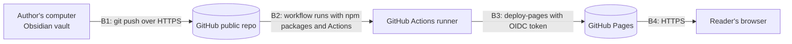

# Security: System Design from First Principles (website)

**ASVS target: Level 1.** A static site with no accounts, no reader input and no personal data about readers. The relevant ASVS areas are encoding and output (V1/V5), configuration and dependencies (V13/V14) and secure communication (V12). There's no authentication, session or access-control surface on the site itself.

## Trust boundaries

## Threat model (STRIDE)
| Boundary | Threat | Example | Mitigation |
|---|---|---|---|
| B1 | Spoofing | Someone takes over the author's GitHub account and defaces the site | Two-factor authentication on the GitHub account (author action, in the launch checklist); branch protection on `main`, blocking force-pushes |
| B1 | Information disclosure | A draft, private note or secret is pushed to the public repository | Accepted for drafts (CNF-003). Secrets: gitleaks in a pre-commit hook and in CI fails on any secret; the site needs no secrets at all |
| B2 | Tampering (supply chain) | A malicious npm release or a hijacked Action | 7-day release-age cooldown; lockfile with `npm ci`; exact versions; Actions pinned to full commit SHAs; `npm audit` in CI; Dependabot with a cooldown; no install scripts allowed for new dependencies without an ADR |
| B2 | Elevation of privilege | A workflow step gets write access it shouldn't have | `permissions: contents: read` by default; only the deploy job gets `pages: write` and `id-token: write`; no `pull_request_target`; workflows run only on pushes to `main` and on pull requests from the same repository |
| B3 | Tampering | A failed or partial build is deployed | The deploy job `needs:` every check job; the Pages artifact is built once and deployed as is |
| B4 | Tampering / disclosure in transit | Content altered on the network | GitHub Pages "Enforce HTTPS" (on by default for github.io) |
| B4 | Cross-site scripting | Raw HTML pasted into a note includes a script | The author is trusted, but there's defence in depth: a CSP meta tag `default-src 'self'; script-src 'self'; style-src 'self' 'unsafe-inline'; img-src 'self' data:; font-src 'self'; object-src 'none'; base-uri 'self'; form-action 'none'`. SVGs are shown as ``, where scripts never run; a figure also links to its SVG, which opens as a document, so the build refuses any SVG with script, event handlers, `<foreignObject>` or `javascript:` links (E-DIAGRAM-UNSAFE, R-08 review). Astro is configured to emit scripts as files, never inline |
| B4 | Information disclosure (privacy) | Third-party requests leak readers' IP addresses | No third-party requests (NFR-008), checked by an end-to-end test |
| B4 | Denial of service | Traffic spike | GitHub's CDN; soft 100 GB a month limit, far above ASM-003 |
| B4 | Repudiation | — | Not applicable: readers take no actions; git history records every content change |

`'unsafe-inline'` for styles is needed for KaTeX's style attributes (ADR-0008). It covers styles only, never scripts. GitHub Pages can't set HTTP headers, so `frame-ancestors` and HSTS preload aren't available. Clickjacking risk is negligible for a read-only site.

## Authorization matrix
The site has no roles. Repository and pipeline permissions:

| Actor | Repository contents | Settings / Pages config | Workflow token: contents | pages | id-token |
|---|---|---|---|---|---|
| Author (owner) | write | admin | — | — | — |
| Anyone else | read (public), pull requests only | none | — | — | — |
| CI check jobs | — | — | read | none | none |
| CI deploy job | — | — | none (job-level permissions replace the default) | write | write |

## Security checklist for this project
- [x] No secrets in the repository (gitleaks clean).
- [x] Every internal link goes through `url()`, and no external script, style or font is referenced.
- [x] The CSP meta tag is present on every page, and Playwright sees no CSP violations.
- [x] Dependencies are added only with an ADR, a stack.md row and a verified version past the cooldown.
- [x] Actions are pinned by SHA, and job permissions are least-privilege.

## Review results (T-04.01, 2026-11-27)
Walked every row of the threat model and the checklist above. Re-run before launch and after any change to the workflow, the `<head>` or the dependencies.

| Check | Result | Evidence |
|---|---|---|
| No third-party requests, no cookies, no browser storage (NFR-008, B4) | Pass | `tests/e2e/security.spec.ts` on every page of the fixture build (home, contents, two chapters, archive, article, About, 404, both redirect pages), light and dark, JavaScript on and off, 320/768/1280 px, after reading each page to the end: every request is same-origin, no cookie, `localStorage`, `sessionStorage` and `document.cookie` empty. The per-page list of requests and cookies is attached to the test report |
| CSP meta on every page, no violations (B4) | Pass | The same spec: one CSP meta with exactly the policy above on every page, before any script, link or style; no CSP violation while opening the sections sheet, the diagram viewer (with zoom) and a margin note. The real build: all 5 pages carry it |
| No inline scripts or handlers (B4) | Pass | The same spec: no `<script>` without `src`, no script from outside the base path, no `on…=` attribute, no `javascript:` link, on any page. The real build: its 3 script tags (all on Chapter 1) are `type="module"` files under the base path |
| Internal links under the base path | Pass | The ESLint rule that sends internal links through `url()` (`.site/eslint.config.js`, ADR-0007), and `tools links`: 96 internal addresses resolve, all under the base path |
| Secrets (B1) | Pass | gitleaks 8.30.1 over the whole history (78 commits): no leaks; CI scans every push |
| Dependencies (B2) | Pass | `npm audit --audit-level=high`: nothing high or critical; `tools audit` passed; every direct dependency has a stack.md row. Accepted, all below the CI threshold: glob and minimatch (moderate) inside linkinator, a dev-only link checker that reads only our own `dist/`; KaTeX 0.16.47 (low, prototype pollution bypassing `trust`) nested under micromark-extension-math, used only by its HTML renderer, which the site doesn't call (the site renders math with KaTeX 0.19.1 from its own math step, `plugins/math.ts`, ADR-0008) |
| Actions pinned, least privilege (B2) | Pass | Every `uses:` is a 40-character SHA; top-level `contents: read`; only `deploy` gets `pages: write` and `id-token: write`; every checkout sets `persist-credentials: false` (pins and permissions: `tests/workflow.test.ts`; checkouts: `tests/e2e/security.spec.ts`) |
| Only the repository's own code runs: pushes, same-repository pull requests, manual runs and the Monday audit (B2) | **Fixed** | The workflow ran any pull request, forks included (read-only token and no secrets, so low risk). `checks`, `secrets` and `e2e` now skip pull requests from forks, and `build` and `deploy` need them; `workflow_dispatch` needs write access and `schedule` runs `main`; no `pull_request_target` or `workflow_run` (guarded in `tests/e2e/security.spec.ts`). Side effect: GitHub reports a skipped job as a success, even as a required check, so a fork's pull request shows green with nothing run. Before merging one, bring its branch into this repository and open a pull request from it there, which runs every check (plan/launch-checklist.md); a bad merge still fails on the push to `main`, which blocks the deploy |
| Failed or partial build deployed (B3) | Pass | `deploy` needs `build`, which needs every check job; the Pages artifact is uploaded only after size, links and Lighthouse pass (R-14's failed Lighthouse run kept the old site live) |
| Account takeover (B1), HTTPS (B4) | Author | 2FA, branch protection and Enforce HTTPS are settings only the author can check: they go in `plan/launch-checklist.md` (T-04.05), Enforce HTTPS included |
