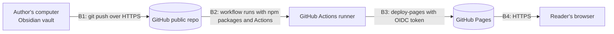

# Security: System Design from First Principles (website)

**ASVS target: Level 1.** A static site with no accounts, no reader input and no personal data about readers. The relevant ASVS areas are encoding and output (V1/V5), configuration and dependencies (V13/V14) and secure communication (V12). There's no authentication, session or access-control surface on the site itself.

## Trust boundaries

## Threat model (STRIDE)
| Boundary | Threat | Example | Mitigation |
|---|---|---|---|
| B1 | Spoofing | Someone takes over the author's GitHub account and defaces the site | Two-factor authentication on the GitHub account (author action, in the launch checklist); branch protection on `main`, blocking force-pushes |
| B1 | Information disclosure | A draft, private note or secret is pushed to the public repository | Accepted for drafts (CNF-003). Secrets: gitleaks in a pre-commit hook and in CI fails on any secret; the site needs no secrets at all |
| B2 | Tampering (supply chain) | A malicious npm release or a hijacked Action | 7-day release-age cooldown; lockfile with `npm ci`; exact versions; Actions pinned to full commit SHAs; `npm audit` in CI; Dependabot with a cooldown; no install scripts allowed for new dependencies without an ADR |
| B2 | Elevation of privilege | A workflow step gets write access it shouldn't have | `permissions: contents: read` by default; only the deploy job gets `pages: write` and `id-token: write`; no `pull_request_target`; workflows run only on pushes to `main` and on pull requests from the same repository |
| B3 | Tampering | A failed or partial build is deployed | The deploy job `needs:` every check job; the Pages artifact is built once and deployed as is |
| B4 | Tampering / disclosure in transit | Content altered on the network | GitHub Pages "Enforce HTTPS" (on by default for github.io) |
| B4 | Cross-site scripting | Raw HTML pasted into a note includes a script | The author is trusted, but there's defence in depth: a CSP meta tag `default-src 'self'; script-src 'self'; style-src 'self' 'unsafe-inline'; img-src 'self' data:; font-src 'self'; object-src 'none'; base-uri 'self'; form-action 'none'`. SVGs are shown as ``, so their scripts never run. Astro is configured to emit scripts as files, never inline |
| B4 | Information disclosure (privacy) | Third-party requests leak readers' IP addresses | No third-party requests (NFR-008), checked by an end-to-end test |
| B4 | Denial of service | Traffic spike | GitHub's CDN; soft 100 GB a month limit, far above ASM-003 |
| B4 | Repudiation | — | Not applicable: readers take no actions; git history records every content change |

`'unsafe-inline'` for styles is needed for KaTeX's style attributes (ADR-0008). It covers styles only, never scripts. GitHub Pages can't set HTTP headers, so `frame-ancestors` and HSTS preload aren't available. Clickjacking risk is negligible for a read-only site.

## Authorization matrix
The site has no roles. Repository and pipeline permissions:

| Actor | Repository contents | Settings / Pages config | Workflow token: contents | pages | id-token |
|---|---|---|---|---|---|
| Author (owner) | write | admin | — | — | — |
| Anyone else | read (public), pull requests only | none | — | — | — |
| CI check jobs | — | — | read | none | none |
| CI deploy job | — | — | none (job-level permissions replace the default) | write | write |

## Security checklist for this project
- [ ] No secrets in the repository (gitleaks clean).
- [ ] Every internal link goes through `url()`, and no external script, style or font is referenced.
- [ ] The CSP meta tag is present on every page, and Playwright sees no CSP violations.
- [ ] Dependencies are added only with an ADR, a stack.md row and a verified version past the cooldown.
- [ ] Actions are pinned by SHA, and job permissions are least-privilege.
